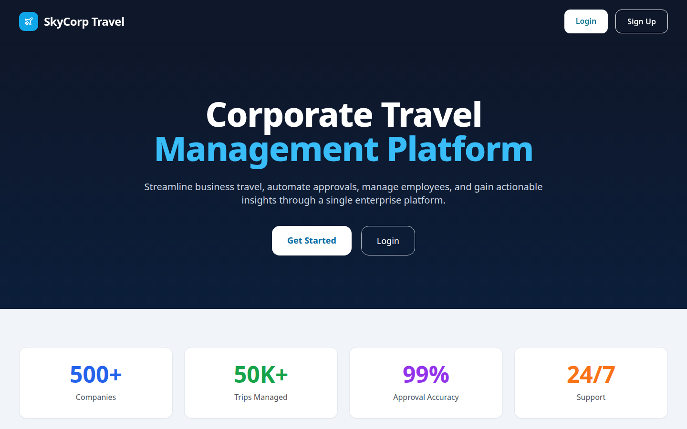
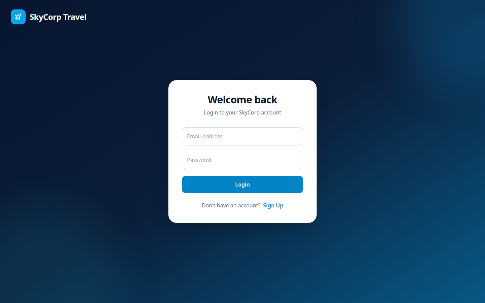
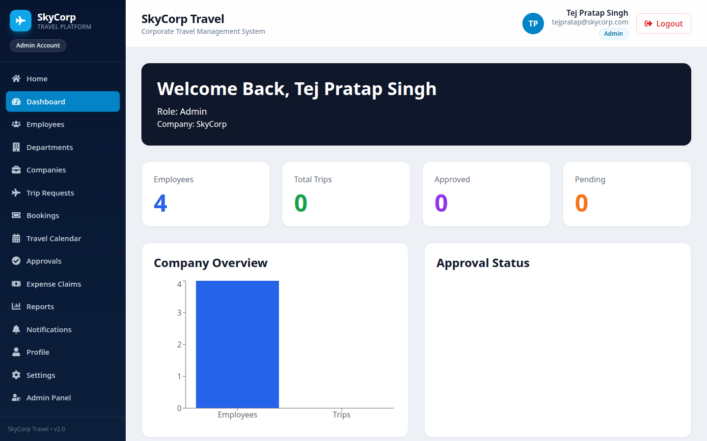
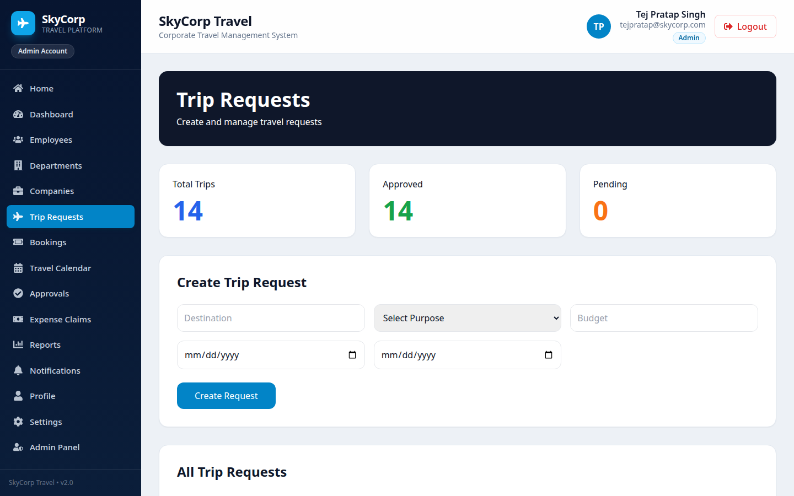
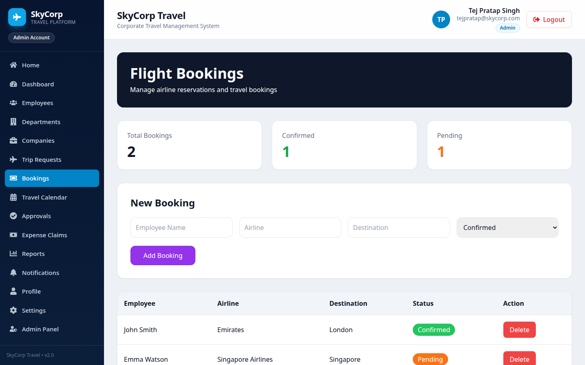
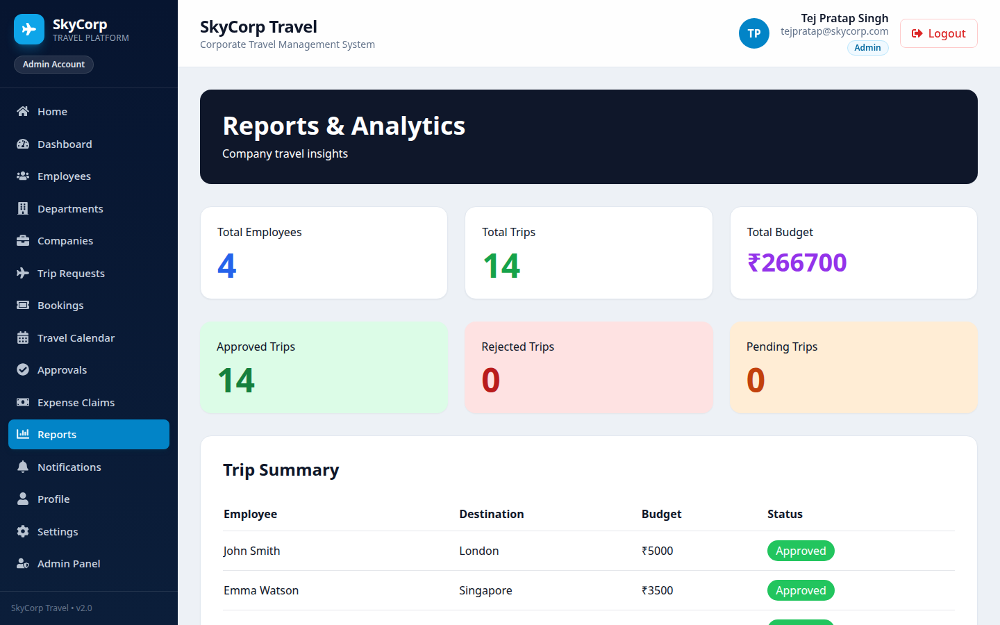

# ✈ SkyCorp Travel - Corporate Travel Management System

## 📌 Project Overview

SkyCorp Travel is a Corporate Travel Management System developed to streamline business travel operations within organizations. The platform enables employees, managers, and administrators to efficiently manage travel requests, approvals, bookings, expense claims, notifications, and reporting through a centralized dashboard.

The system provides role-based access control and simplifies corporate travel planning while improving transparency and operational efficiency.

---

## 📸 Screenshots

### Landing Page



### Login



### Admin Dashboard



### Trip Requests



### Flight Bookings



### Reports & Analytics



---

## 🚀 Features

### 👨‍💼 Employee Features

* User Registration & Login
* Create Travel Requests
* View My Trips
* Travel History
* Submit Expense Claims
* Notifications
* Profile Management
* Support Center
* Settings

### 👨‍💻 Manager Features

* Dashboard Overview
* Employee Management
* Company Management
* Review Travel Requests
* Manage Bookings
* Travel Calendar
* Expense Monitoring
* Reports & Analytics
* Notifications

### 🔐 Admin Features

* Complete System Access
* Employee Management
* Department Management
* Company Management
* Travel Approval Control
* Booking Management
* Expense Claim Monitoring
* Reports & Analytics
* User Administration

---

## 🛠️ Technologies Used

### Frontend

* React.js
* React Router DOM
* Tailwind CSS
* React Icons
* Lucide React
* React Hot Toast

### Backend

* Node.js + Express (in `backend/`)
* REST API
* JSON Server (legacy mock)

### Database

* db.json

### Development Tools

* Visual Studio Code
* Git
* GitHub

---

## 🖥️ Backend

A real **Node.js + Express** REST API lives in [`backend/`](backend/) and serves the frontend on **http://localhost:3001** — the same routes and port the app already uses, so the frontend works unchanged (the original json-server mock still works too, if you prefer it).

```bash
cd backend
npm install
npm start
```

It provides full CRUD (`GET` / `POST` / `PATCH` / `PUT` / `DELETE`) for `users`, `employees`, `trips`, `bookings`, `companies`, `departments`, `expenses`, `calendar`, `notifications`, `reports`, `analytics` and `settings`, with every change persisted to `backend/data/db.json`. See [backend/README.md](backend/README.md) for the full endpoint list.

---

## 📂 Project Structure

```bash
src/
│
├── components/
├── layouts/
├── pages/
│   ├── Dashboard.jsx
│   ├── Employees.jsx
│   ├── Companies.jsx
│   ├── TripRequests.jsx
│   ├── Bookings.jsx
│   ├── TravelCalendar.jsx
│   ├── ExpenseClaims.jsx
│   ├── Reports.jsx
│   ├── Notifications.jsx
│   ├── MyTrips.jsx
│   ├── TravelHistory.jsx
│   ├── Profile.jsx
│   ├── Settings.jsx
│   └── Support.jsx
│
├── routes/
├── api/
└── App.jsx
```

---

## 📊 Modules Implemented

### Employee Management

* Add Employees
* Manage Employee Records
* Department Allocation

### Travel Request Management

* Create Travel Requests
* Purpose Selection
* Budget Management
* Travel Dates Validation

### Approval Workflow

* Approve Requests
* Reject Requests
* Status Tracking

### Booking Management

* Flight Booking Records
* Booking Status Tracking

### Expense Claims

* Travel Expense Submission
* Expense Categories
* Approval Tracking

### Reports & Analytics

* Employee Statistics
* Trip Analytics
* Expense Analysis
* Budget Monitoring

### Notifications

* System Notifications
* Activity Updates

---

## 🔒 Role-Based Access

### Admin

* Full System Access

### Manager

* Company-Level Management Access

### Employee

* Personal Travel Management Access

---

## ⚙️ Installation

### Clone Repository

```bash
git clone https://github.com/Tejpratap-069/airline-corporate-travel-portal.git
```

### Install Dependencies

```bash
npm install
```

### Start JSON Server

```bash
npx json-server --watch db.json --port 5000
```

### Start React Application

```bash
npm run dev
```

---

## 🔑 Admin Login

```text
Email: tejpratap@skycorp.com
Password: admin123
```

---

## 📈 Future Enhancements

* Flight API Integration
* Hotel Booking Integration
* PDF Report Generation
* Email Notifications
* Expense Receipt Upload
* Interactive Dashboard Charts
* Real-Time Approval System

---

## 🎓 Academic Information

Project Title:
Corporate Travel Management System (SkyCorp Travel)

Developed As:
Mini Project / Academic Project

Department:
Computer Science Engineering

---

## 👨‍💻 Developer

Tej Pratap Singh

GitHub:
https://github.com/Tejpratap-069

---

© 2026 SkyCorp Travel. All Rights Reserved.
